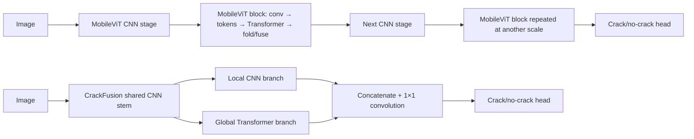

# MobileViT-XS baseline and CrackFusion-Tiny

**Tags:** `MobileViT` `MobileViT-XS` `CNN-Transformer` `baseline` `architecture` `SDNET2018` `transfer-learning`

## Short answer

MobileViT-XS is already a CNN–Transformer hybrid. The useful comparison is therefore **MobileViT-XS versus CrackFusion-Tiny**, two hybrids with different arrangements of convolution and attention.

MobileViT-XS puts convolution and Transformer operations together repeatedly inside a compact, staged network. CrackFusion-Tiny splits a shared CNN representation into two parallel paths, one convolutional and one Transformer-based, then fuses their feature maps once. The project uses pretrained MobileViT-XS as an established transfer-learning reference; CrackFusion-Tiny is the proposed custom model.

## What the project actually implements

The model itself is not reimplemented in the baseline notebook. The notebook calls the `timm` model factory with the public ImageNet-1K checkpoint, replaces its classifier with a one-logit head, freezes the backbone for five head-only epochs, and then fine-tunes the full network for up to 50 more epochs with early stopping. It selects validation macro-F1 and uses seeds 42, 1337 and 2026 on the same development manifest as CrackFusion. Resumable checkpoints include optimizer, AMP, phase and random states. The older three-plus-five-epoch prototype is retired.

The implementation is in [`notebooks/02_mobilevit_train.ipynb`](../../notebooks/02_mobilevit_train.ipynb). The model identifier is `mobilevit_xs.cvnets_in1k`; the code asks `timm` to resolve the model's input and normalization configuration. The official model card identifies the original 1,000-class ImageNet checkpoint as approximately 2.33 million parameters and lists a 256×256 model input. Our code replaces the original classifier with one output. The [`timm` XS configuration](https://github.com/huggingface/pytorch-image-models/blob/main/timm/models/mobilevit.py) has a 384-feature classifier input, so the crack-task model is smaller than the published 1,000-class model; the verified binary model has **1,933,233 parameters** with `timm==1.0.20`. The notebook records the instantiated count and software versions with its results.

**Status caution:** this notebook describes its output as pipeline validation only. Its tile-level split may put tiles from the same parent photograph in both training and validation. Its score is not a final research result.

## How MobileViT works

MobileViT was introduced as a general-purpose, mobile-oriented vision architecture. It mixes convolution and self-attention inside repeated MobileViT blocks:

1. Convolutions extract local patterns from a feature map.
2. The feature map is unfolded into patches/tokens while preserving spatial structure.
3. Transformer layers allow information to pass between distant image regions.
4. The sequence is folded back into a spatial feature map.
5. The result is concatenated with a local feature/input path and projected with convolution.

This operation is used at multiple stages of the network. In broad terms, it is a **serial, staged hybrid**: the evolving feature stream passes through convolution and Transformer operations repeatedly. It does not keep one independent CNN classifier branch and one independent Transformer classifier branch until a single final join.

Primary sources: [MobileViT paper (ICLR 2022)](https://openreview.net/forum?id=vh-0sUt8HlG), [Apple research page](https://machinelearning.apple.com/research/vision-transformer), [official Apple implementation](https://github.com/apple/ml-cvnets), and [`timm` MobileViT-XS ImageNet model card](https://huggingface.co/timm/mobilevit_xs.cvnets_in1k).

The paper reports MobileViT-XS at about 2.3M parameters and 74.8% ImageNet-1K top-1 accuracy in its stated configuration. This is a general-image benchmark result, not a concrete-crack score. FLOPs/GMAC figures vary with the input resolution and accounting convention; report the input size alongside them.

## MobileViT already used for crack classification

Şermet and Pacal (2024) evaluate MobileViT-XS, MobileViT-S/XXS, and MobileViTv2 variants alongside CNN and Transformer models on SDNET2018. This is useful prior work for selecting MobileViT-XS as a crack-classification baseline. Their MobileViT models are alternative backbones in a comparison, not a new parallel CNN–Transformer fusion architecture. The paper reports a 70/15/15 image split, but does not establish that all tiles from each original SDNET photograph were kept in one partition, so its scores should not be directly compared with a source-photo-separated result. [Article](https://dergipark.org.tr/en/pub/dumf/article/1450640) · [Full paper](https://dergipark.org.tr/en/download/article-file/3785322)

## How it differs from CrackFusion-Tiny

| Design question | MobileViT-XS baseline | CrackFusion-Tiny |
|---|---|---|
| Original purpose | General mobile vision model, pretrained on ImageNet-1K | Project-specific compact concrete-crack classifier |
| Overall layout | A sequence of convolutional stages with MobileViT blocks inserted at several scales | Shared CNN stem, then parallel local CNN and global Transformer branches |
| Local/global interaction | Repeated inside MobileViT blocks through unfold → Transformer → fold → convolutional fusion | Branch feature maps are concatenated once, then reduced by a 1×1 convolution |
| Attention input | Structured tokens taken from intermediate feature maps | 14×14 map becomes 196 tokens of width 96; two four-head Transformer encoder layers |
| Classifier output in this project | Replaced with one logit for crack/no-crack | One logit for crack/no-crack |
| Initialization in the current plan | ImageNet-pretrained backbone; head warm-up followed by full fine-tuning | Custom network; controlled architecture experiments are planned from scratch |
| Approximate trainable parameters | About 2.33M for the original 1,000-class checkpoint; 1,933,233 after replacing its classifier with one logit (`timm==1.0.20`) | 284,337 in the implemented graph |

After replacing the MobileViT-XS 1,000-class head, its parameter count is roughly seven times CrackFusion-Tiny's. That supports a size comparison, but it does **not** establish that CrackFusion-Tiny is faster: latency depends on the device, kernels, input size, batch size, and implementation. Measure latency under the same hardware and timing procedure.

The project's model definition is [`notebooks/03_crackfusion_train.ipynb`](../../notebooks/03_crackfusion_train.ipynb), and the planned comparisons are in [`docs/planning/experimental_protocol.md`](../planning/experimental_protocol.md).

## What a fair comparison can and cannot show

MobileViT-XS answers a practical question: **how does our compact crack model compare with a known, pretrained mobile hybrid fine-tuned for this task?** Because its ImageNet weights provide substantial prior training, it should be reported as a transfer-learning reference.

The CNN-only, Transformer-only, serial-hybrid, and parallel-fusion experiments answer a different, more controlled question: **does the local/global arrangement or fusion itself help?** For that claim, keep data partitions, image size, data augmentation, optimizer budget, and initialization policy matched as closely as possible. Report any unavoidable differences.

Before treating MobileViT as a research comparison, resolve these protocol details:

- Verify the actual input resolution used by the `timm` transform and decide whether every model gets the same resolution. CrackFusion-Tiny currently requires 224×224 input; the published `timm` MobileViT-XS configuration lists 256×256.
- Make the final split at the original-photo group level. Do not use the current tile-development split for paper claims.
- Keep the pretrained MobileViT result clearly labelled as transfer learning; do not describe a gap against a from-scratch model as a pure architecture effect.
- Use repeated seeds and report crack recall/F1 plus balanced metrics, per-surface results, parameter count, and measured latency.

## Research interpretation

MobileViT is an appropriate baseline because it is a well-known compact CNN–Transformer model and offers ImageNet transfer learning. Its presence also means the paper cannot frame “combining CNN and Transformer” as the novelty. The more defensible question is whether the much smaller, explicitly parallel CrackFusion-Tiny design provides a useful accuracy/generalization/efficiency trade-off under source-separated and cross-surface evaluation.

See also: [crack classification hybrids](crack_classification_hybrids.md), [detection and segmentation hybrids](detection_segmentation_hybrids.md), and [datasets/evaluation](datasets_evaluation_and_gaps.md).
